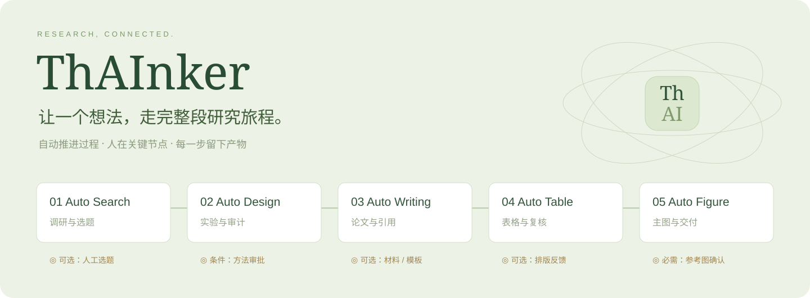
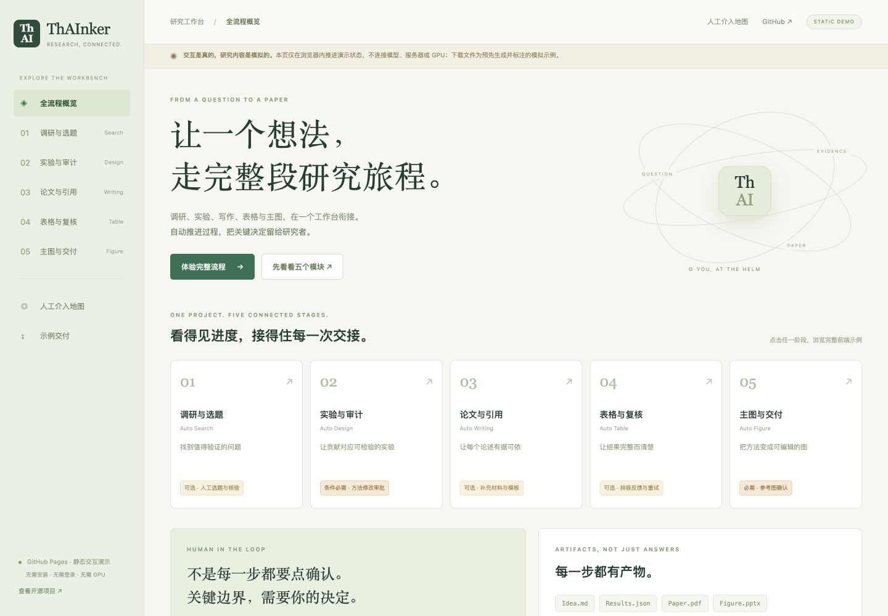
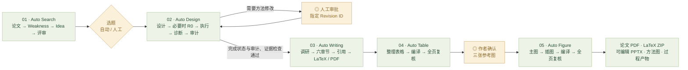
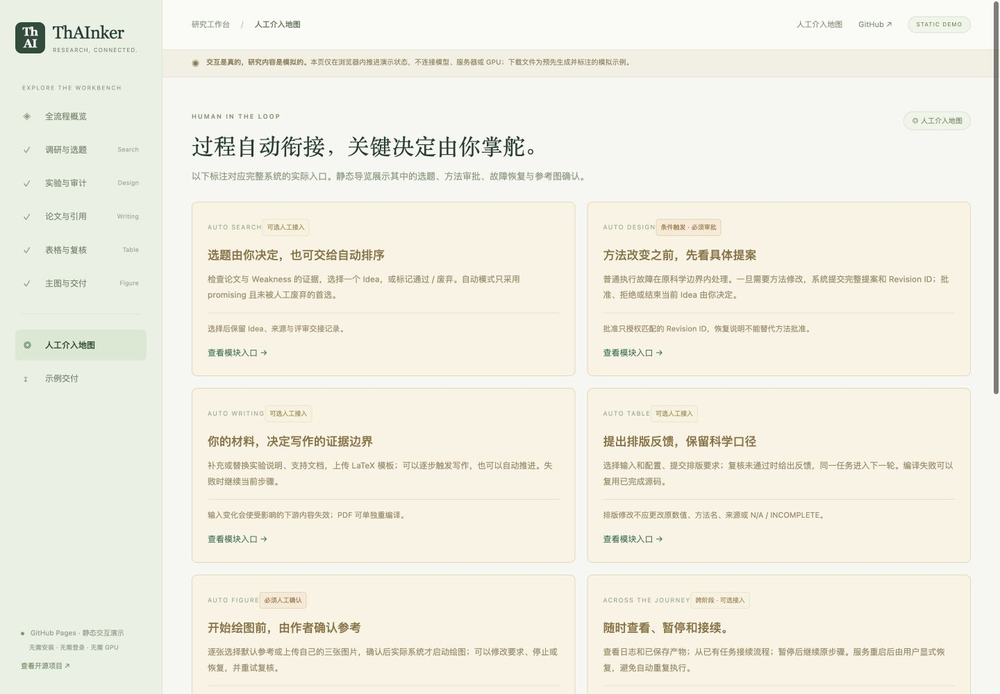
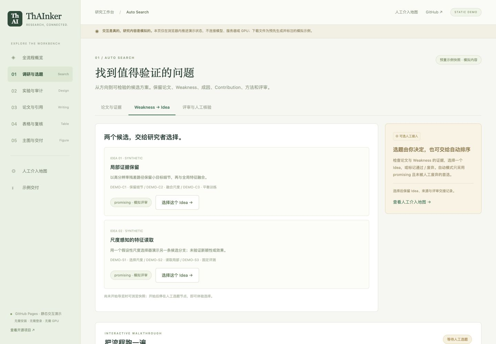
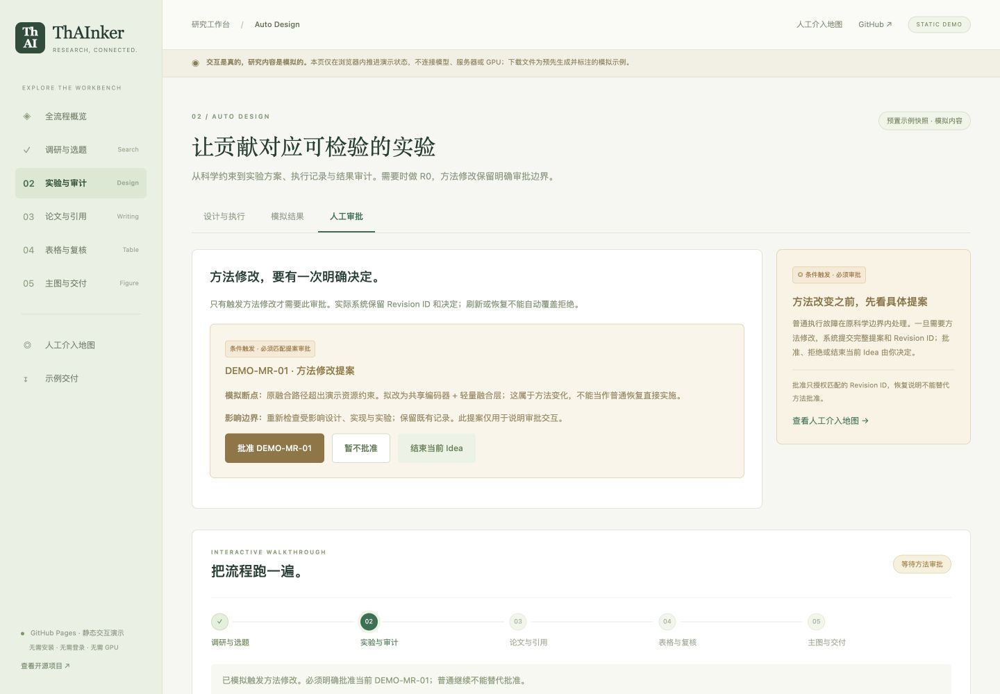
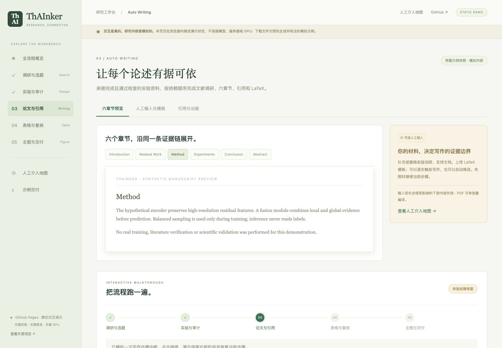
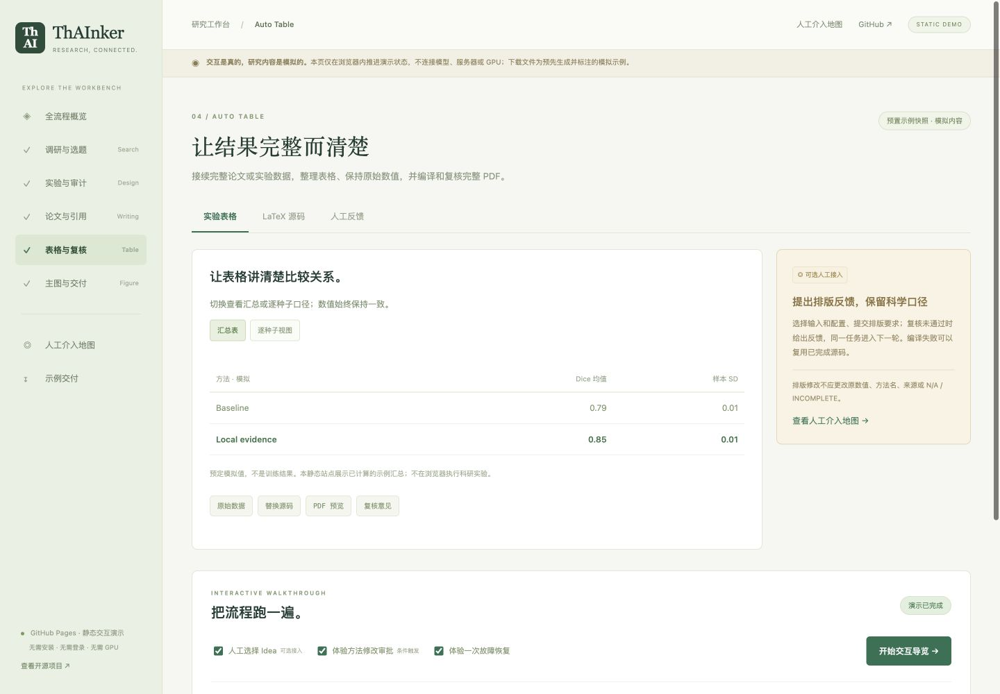
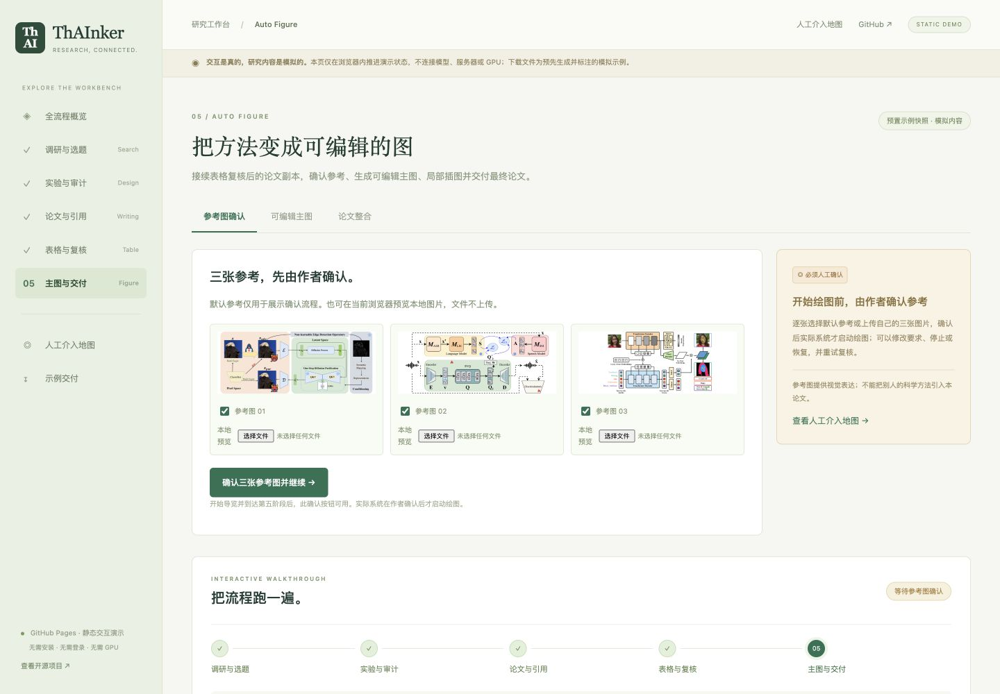

<div align="center">



### Research, connected. Researchers, in control.

**从研究方向到论文交付的五阶段工作台。自动推进过程，把关键决定留给研究者。**

[**▶ 体验在线 Demo**](https://goya4140.github.io/ThAInker/) · [**◎ 人工介入地图**](https://goya4140.github.io/ThAInker/#human) · [**↧ 示例交付**](https://goya4140.github.io/ThAInker/#delivery) · [本地运行](#本地运行)

`5 个研究模块`　`可选接入 / 条件审批 / 必需确认`　`MIT 开源`

</div>

---

## 不止展示一张图，亲手走一遍流程

[](https://goya4140.github.io/ThAInker/)

进入 [**GitHub Pages 在线 Demo**](https://goya4140.github.io/ThAInker/)，无需安装、账号或 GPU：

1. **浏览五个模块**：看论文卡、候选 Idea、实验方案、六章节写作、表格与可编辑主图。
2. **做一次研究者的决定**：选择 Idea，批准或拒绝指定方法提案，确认三张参考图。
3. **体验中途接管**：暂停、继续，或处理一次模拟写作中断，观察流程如何接续。
4. **带走一份示例**：下载预生成的论文 PDF、LaTeX 源码、PPTX 主图与逐种子模拟数据。

> [!NOTE]
> 在线 Demo 是**纯静态前端交互**。研究内容、评分、评审与数据均为模拟；浏览器不会调用模型、服务器、GPU 或编译器。下载文件由本地离线演示预先生成，并带有 DEMO / SYNTHETIC 标记。

## 一条研究旅程，五次有据可查的交接



每个模块都保留独立入口。你可以从研究方向开始，也可以接续已有调研、实验、写作或表格任务。Research Journey 用保存的记录展示当前阶段、分支、事件与关联产物。[流程与恢复设计 →](docs/frontend_workflow.md)

## ◎ 人在什么地方接入？

**不是每一步都要确认。不同边界，对应不同的人工决定。**

| 接入位置 | 人可以做什么 | 触发方式 | 自动推进的边界 |
| --- | --- | --- | --- |
| **开始研究** | 给出方向、科学意图、可选 Benchmark、材料与资源约束；选择起点 | 开始前输入 | 保留用户提供的科学约束 |
| **Search · 选题与核验** | 查看证据、选择 Idea，标记通过 / 废弃并可撤销核验 | **可选接入** | 自动模式仅取 `promising`、未被人工废弃的首选 |
| **Design · 方法修改** | 阅读完整提案；批准匹配的 Revision ID、拒绝或结束当前 Idea | **条件触发，必须审批** | 普通“继续”和恢复说明不能替代方法批准 |
| **Writing · 材料与模板** | 补充实验说明和支持资料，替换模板，逐步生成或自动继续 | **可选接入** | 输入变化使受影响产物失效；编译可单独重试 |
| **Table · 排版与反馈** | 选择输入和配置、提出要求；复核失败后带反馈进入下一轮 | **可选接入** | 保留原数值、方法名、来源及 `N/A` / `INCOMPLETE` |
| **Figure · 参考图** | 逐张选择默认图或上传三张图片，再明确确认 | **必须确认** | 未确认不启动真实绘图；参考只影响视觉表达 |
| **跨阶段控制** | 查看日志、暂停、恢复、从已有任务接续 | **按需接入** | 保留完成步骤；服务重启后由用户显式继续 |

> **拒绝不会被自动流程覆盖。** 停止实验控制器也不等于远端训练已经停止；恢复前仍需核对在途执行。

[**打开可交互的人工介入地图 ↗**](https://goya4140.github.io/ThAInker/#human)

<details>
<summary><strong>◎ 展开查看人工介入地图界面</strong></summary>

[](https://goya4140.github.io/ThAInker/#human)

</details>

## 五个模块，逐屏展开

以下为在线静态演示的界面，使用预置模拟内容；每一屏都标出对应的人工入口。点击标题展开截图，或直接进入在线模块。

<details open>
<summary><strong>01 · Auto Search｜从方向到值得验证的问题</strong></summary>

**输入**：研究方向或具体 Weakness。**产物**：论文与证据、成因、Contribution、方法、Benchmark 和评审。

**◎ 人工入口**：核验来源、选择候选、通过 / 废弃；也可自动选题。

[](https://goya4140.github.io/ThAInker/#search)

[进入在线调研模块 ↗](https://goya4140.github.io/ThAInker/#search) · [模块说明](auto_search/README.md)

</details>

<details>
<summary><strong>02 · Auto Design｜把贡献变成可检验的实验</strong></summary>

**输入**：选定 Idea 与科学约束。**产物**：设计、必要时 R0、命令与执行记录、逐 seed 结果、诊断和审计。

**◎ 人工入口**：仅设计 / 完整执行、暂停恢复；发生方法修改时审批指定提案。

[](https://goya4140.github.io/ThAInker/#design)

[进入在线实验模块 ↗](https://goya4140.github.io/ThAInker/#design) · [模块说明](auto_design/README.md)

</details>

<details>
<summary><strong>03 · Auto Writing｜沿证据链写作，沿依赖推进</strong></summary>

**输入**：通过检查的实验资料、补充材料与可选模板。**产物**：六章节、文献与引用、LaTeX 工程和 PDF。

**◎ 人工入口**：补充或替换输入、选择模板、逐步启动或自动完成、失败处继续。

[](https://goya4140.github.io/ThAInker/#writing)

[进入在线写作模块 ↗](https://goya4140.github.io/ThAInker/#writing) · [模块说明](auto_writing/README.md)

</details>

<details>
<summary><strong>04 · Auto Table｜让比较清楚，保持数值不变</strong></summary>

**输入**：完整论文 ZIP 或结构化实验结果。**产物**：表格、来源记录、LaTeX / HTML / PDF 与复核。

**◎ 人工入口**：输入与配置、排版要求、复核反馈和同任务修订。

[](https://goya4140.github.io/ThAInker/#table)

[进入在线表格模块 ↗](https://goya4140.github.io/ThAInker/#table) · [模块说明](auto_table/README.md)

</details>

<details>
<summary><strong>05 · Auto Figure｜确认参考，把方法变成可编辑的图</strong></summary>

**输入**：表格复核后的论文副本与三张参考图。**产物**：原生 PPTX、独立主图 PDF / PNG、含图论文与源码。

**◎ 人工入口**：默认 / 自有参考图选择和确认、修改要求、暂停恢复与复核重试。

[](https://goya4140.github.io/ThAInker/#figure)

[进入在线绘图模块 ↗](https://goya4140.github.io/ThAInker/#figure) · [模块说明](auto_figure/README.md)

</details>

## 三种体验方式

| | GitHub Pages 在线 Demo | 本地离线 Demo | 完整研究工作台 |
| --- | --- | --- | --- |
| 适合 | 产品导览、宣传、前端交互 | 端到端软件演示与验收 | 真实研究任务 |
| 需要安装 | 无 | Python、演示依赖和 LaTeX | Python、Codex CLI；实验与绘图按模块配置 |
| 模型 / GPU | 不调用 | 预置模型响应，CPU 模拟实验 | 按任务、模型和资源真实执行 |
| 页面状态 | 浏览器内模拟 | 原任务管理器与调度器 | 原任务管理器与调度器 |
| 编译与下载 | 预生成模拟样例 | 本机真实编译、生成与下载 | 按实际执行结果交付 |
| 研究结论 | 不产生 | 不产生 | 必须以真实证据、诊断与审计为准 |

## 本地运行

### 离线演示：不接 GPU，也能验证软件交接

```bash
git clone https://github.com/goya4140/ThAInker.git
cd ThAInker
uv venv --python 3.12 .venv
uv pip install --python .venv/bin/python -e '.[demo]'
.venv/bin/python -m workbench.demo --port 8769
```

打开 <http://127.0.0.1:8769/demo.html>。需要本机已有 LaTeX 编译器；模拟数据独立保存在 `assets/output/demo/`。可体验人工选题、故障恢复和参考图确认。细节见[离线演示说明](docs/DEMO.zh-CN.md)。

### 完整工作台：连接自己的研究环境

```bash
.venv/bin/python -m workbench --port 8760
```

打开 <http://127.0.0.1:8760/>。真实调用需要已登录的 Codex CLI，具体实验依赖与资源由任务决定；绘图需要单独配置 FigureCrafter 环境。启动服务本身不会自动启动研究任务。[工作台说明](workbench/README.md) · [绘图环境](auto_figure/README.md)

## 继续了解

| 入口 | 内容 |
| --- | --- |
| [静态站点维护与部署](docs/GITHUB_PAGES.zh-CN.md) | 如何本地预览、更新公开样例与发布 GitHub Pages |
| [本地演示说明](docs/DEMO.zh-CN.md) | 模拟边界、运行方式、隔离目录和验收 |
| [全流程与恢复](docs/frontend_workflow.md) | 交接门槛、暂停、恢复、审批与版本失效 |
| [Research Journey](docs/RESEARCH_JOURNEY.zh-CN.md) | 科研航线、分支、事件和真实指标 |
| [图文使用手册](docs/USER_MANUAL.zh-CN.md) | 完整工作台操作指引 |
| [原 AutoResearch 功能与 CLI](docs/AUTORESEARCH_GUIDE.md) | 证据检索、PaperCard、MOC、Gap 与原命令 |

---

**来源与许可**：ThAInker 基于 [yzbcs/Autoresearch](https://github.com/yzbcs/Autoresearch) 继续完善，保留其研究模块与原始记录，按 [MIT License](LICENSE) 开源。Auto Table、FigureCrafter 等集成来源及许可见各模块说明。公开演示文件均为明确标注的模拟样例，不含本地运行日志或登录信息。
